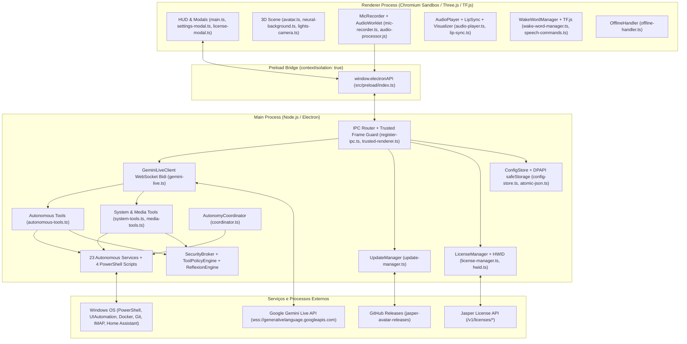

# RELATÓRIO 2 — Mapa Arquitetural

## 2.1 Diagrama da Arquitetura Real do Sistema

---

## 2.2 Divisão de Responsabilidades e Comunicação Entre Processos

### 1. Processo Main (`src/main/`)
O processo Main do Electron atua como orquestrador de segurança e de recursos de baixo nível:
- **Ciclo de vida e janelas (`src/main/index.ts`, `src/main/windows/main-window.ts`):** Registra o protocolo customizado `app://` para entrega dos assets compilados do Renderer; cria a janela principal transparente/frameless de 420x600 pixels posicionada no canto inferior direito da tela principal do Windows; configura o ícone de bandeja (Tray).
- **Roteamento de IPC (`src/main/ipc/register-ipc.ts`):** Registra todos os handlers de comunicação assíncrona recebidos da interface. Aplica a verificação [`isTrustedRendererFrame`](../src/main/utils/trusted-renderer.ts#L1-L10) em cada invocação para garantir que apenas o frame principal da janela autorizada possa invocar ações.
- **Cliente Gemini Live (`src/main/gemini-live.ts`):** Gerencia a conexão WebSocket bidirecional em tempo real com o endpoint `wss://generativelanguage.googleapis.com/ws/google.ai.generativelanguage.v1beta.GenerativeService.BidiGenerateContent`. Envia chunks de áudio PCM 16kHz e recebe chunks de áudio PCM 24kHz, transcrições e chamadas de ferramentas (`functionCall`).
- **Gerenciador de Licenças (`src/main/services/license-manager.ts`):** Valida chaves de ativação contra a API REST do Jasper, armazena leases offline assinados criptograficamente em Ed25519 e valida a integridade do Hardware ID (`HWID`).
- **Subsistema Autônomo (`src/main/autonomous/`):** Composto por 23 classes especializadas que implementam automações locais (gestão de processos, saúde da máquina, automação de UI, controle de mídia, integração Home Assistant, leitura de QR codes, OCR via Tesseract, navegador headless via Electron BrowserWindow, leitor de calendários e e-mails).

### 2. Processo Preload (`src/preload/`)
- Localizado em `src/preload/index.ts`, atua como barreira de contenção rígida utilizando `contextBridge.exposeInMainWorld('electronAPI', {...})`.
- Expõe métodos tipados com canais IPC declarados como constantes centralizadas em `src/shared/constants/ipc-channels.ts`.
- Garante o padrão defensivo de listeners: remove qualquer ouvinte anterior via `ipcRenderer.removeAllListeners(channel)` antes de registrar um novo callback.

### 3. Processo Renderer (`src/renderer/`)
- **Renderização Gráfica 3D (`src/renderer/scene/`):** Construído com Three.js. Renderiza o modelo facial 3D `facecap.glb` (carregado via `GLTFLoader` com extensões KTX2 e Meshopt) com 51 morph targets faciais padrão ARKit, ou renderiza um globo de partículas procedural de fallback (`Orb`). Renderiza ao fundo uma malha de rede neural interativa (`neural-background.ts`) e círculos HUD animados.
- **Captura e Processamento de Áudio (`src/renderer/audio/`):** Captura o microfone do usuário em 16kHz através de um `AudioWorkletNode` (`public/audio-processor.js`) que envia blocos PCM Float32 via mensagem para `MicRecorder`. Detecta atividade de voz (VAD) localmente.
- **Reprodução de Áudio e Lip-Sync (`src/renderer/audio/`):** `AudioPlayer` decodifica os chunks PCM 24kHz recebidos do Gemini Live em buffers de áudio contínuos agendados via `AudioContext.currentTime`. O módulo `LipSync` extrai bandas de frequência de amplitude através de um `AnalyserNode` e atualiza a abertura da boca (`jawOpen`, `mouthPucker`, `mouthFunnel`) do modelo 3D em tempo real.
- **Reconhecimento de Wake Word (`src/renderer/audio/wake-word-manager.ts`):** Carrega localmente o classificador FFT do TensorFlow.js (`@tensorflow-models/speech-commands`), executa inferência em tempo real e ativa o modo conversa ao reconhecer o comando *"Jasper"* (ou ativa o modo offline quando desconectado).

---

## 2.3 Acoplamentos Problemáticos e Pontos Únicos de Falha (SPOFs)

### 1. Efeitos Colaterais no Tempo de Importação dos Módulos (Import-time Side Effects)
Os serviços em `src/main/autonomous/` são instanciados como singletons exportados diretamente (`export const gitWatcher = new GitWatcherService()`). Vários módulos disparam rotinas pesadas e timers ininterruptos dentro do próprio construtor:
- `SystemHealthService` inicia a coleta estática via `systeminformation` no `constructor` antes de qualquer verificação de ativação do módulo.
- `GitWatcherService` inicia um timer de 15 minutos executando comandos Git no repositório padrão mesmo quando `enableGitWatcher` está desativado nas configurações.
- `CalendarEmailService` lê arquivos de calendário do disco e inicia um timer a cada 60 segundos no construtor.
- **Impacto:** Mesmo que um módulo esteja desativado pelo usuário, ele consome recursos e inicia processos na máquina apenas por ser importado pelo processo Main.

### 2. Desconexão Crítica de Módulos com o `AutonomyCoordinator`
O coordenador central (`src/main/autonomous/coordinator.ts`) deveria centralizar o ciclo de vida e a sincronização de eventos de todos os serviços autônomos. Contudo:
- `presentationMode` e `focusMode` sequer são importados ou gerenciados em `coordinator.ts`.
- O coordenador não monitora o estado de `presentationMode.getStatus().isSilentAudio` antes de disparar notificações sonoras para o usuário.
- O modo foco nunca recebe o callback `onNotification`, descartando todos os alertas de interrupção e conclusão de ciclos Pomodoro.

### 3. Duplicação e Divergência na Orquestração de Ferramentas
As ferramentas invocadas pelo modelo Gemini estão divididas entre dois orquestradores que possuem regras de segurança discrepantes:
- `executeSystemTool` (`src/main/tools/system-tools.ts`): Executa ferramentas críticas do sistema (`organize_folder`, `launch_program`, `kill_process`, `execute_sandbox_code`) sem passar pelo `ReflexionEngine`, sem exigir simulação prévia e sem verificar toggles de configuração de módulos em ferramentas como `organize_folder`.
- `executeAutonomyTool` (`src/main/tools/autonomous-tools.ts`): Executa o `ReflexionEngine.preExecutionCheck()`, mas repassa caminhos arbitrários (`repoPath`) sem verificação de contenção para o `GitWatcher`.

### 4. Ausência de Tratamento Global de Exceções
- Em `src/main/index.ts`, não existem handlers para `process.on('uncaughtException')` ou `process.on('unhandledRejection')`. Uma exceção não capturada em qualquer um dos 23 módulos autônomos derruba abruptamente o aplicativo inteiro.
- No Renderer (`src/renderer/main.ts`), não há listeners globais `window.addEventListener('error')` ou `window.addEventListener('unhandledrejection')` para registrar falhas de renderização WebGL ou de áudio em logs de diagnóstico.
