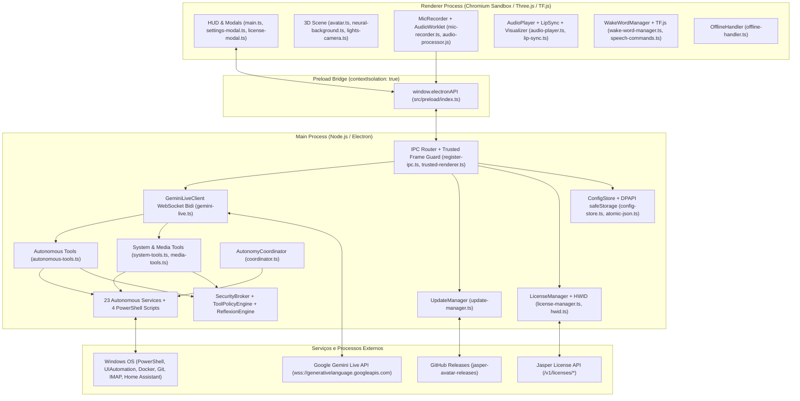

# AUDITORIA TÉCNICA, ARQUITETURAL, FUNCIONAL E DE SEGURANÇA — JASPER AVATAR
**Versão Auditada:** 0.1.3-alpha / 1.0.2  
**Data da Auditoria:** 16 de Outubro de 2026  
**Status do Veredito:** **REPROVADO PARA PRODUÇÃO / DISTRIBUIÇÃO PÚBLICA** (Requer remediações P0/P1 antes do lançamento).

---

# ÍNDICE GERAL
1. [RELATÓRIO 1 — Resumo Executivo](#relatório-1--resumo-executivo)
2. [RELATÓRIO 2 — Mapa Arquitetural](#relatório-2--mapa-arquitetural)
3. [RELATÓRIO 3 — Segurança e Vulnerabilidades](#relatório-3--segurança-e-vulnerabilidades)
4. [RELATÓRIO 4 — Auditoria Funcional dos Módulos](#relatório-4--auditoria-funcional-dos-módulos)
5. [RELATÓRIO 5 — Qualidade, Performance e Bugs](#relatório-5--qualidade-performance-e-bugs)
6. [RELATÓRIO 6 — Testes e Validações](#relatório-6--testes-e-validações)
7. [RELATÓRIO 7 — Build e Distribuição](#relatório-7--build-e-distribuição)
8. [RELATÓRIO 8 — Plano de Correções Priorizado](#relatório-8--plano-de-correções-priorizado)
9. [RELATÓRIO 9 — Preparação para Produção](#relatório-9--preparação-para-produção)
10. [RELATÓRIO 10 — Conclusão](#relatório-10--conclusão)

---

# RELATÓRIO 1 — Resumo Executivo

## 1.1 Visão Geral do Estado Atual do Projeto
O **Jasper Avatar (`v0.1.3-alpha` / `1.0.2`)** apresenta uma fundação arquitetural moderna baseada em **Electron 34 + Vite 6 + TypeScript 5.9 + Three.js**, concebida para atuar como um assistente de inteligência artificial interativo para desktop Windows com avatar 3D, controle de voz em tempo real e automações locais de sistema operacional.

O projeto demonstra esforço arquitetural louvável em termos de isolamento e defesa em profundidade básica do processo de renderização:
- `contextIsolation: true`, `nodeIntegration: false`, `sandbox: true` aplicados rigorosamente na janela principal (`src/main/windows/main-window.ts#L67-L72`).
- Validação estrita do emissor de IPC (`src/main/utils/trusted-renderer.ts#L1-L10`).
- Criptografia local de credenciais e chaves via DPAPI do Windows através de `safeStorage` (`src/main/config/config-store.ts#L34-L52`).
- Gravação atômica de arquivos de configuração com rotação `.bak` para mitigar corrupções de disco (`src/main/utils/atomic-json.ts#L1-L41`).
- Implementação de um avaliador de expressões matemáticas livre de `eval()` e `Function()` no processo Main (`src/main/tools/math-evaluator.ts#L1-L147`).

Contudo, a inspeção estática aprofundada de 100% da base de código revelou **fragilidades críticas que inviabilizam tanto a distribuição pública comercial imediata quanto o uso contínuo estável no Windows**, incluindo:
1. **Bloqueador funcional na conexão com o Gemini Live:** O modelo padrão configurado no código local foi alterado para `gemini-3.8-live` (um identificador inexistente na API pública), impossibilitando o handshake WebSocket básico sob configurações padrão.
2. **Vulnerabilidades de segurança no licenciamento e automação:** Possibilidade de contorno trivial da verificação de licença local por meio de chave pública Ed25519 armazenada em JSON editável; bypass de filtros de janelas sensíveis na automação de UI; execução indireta de arquivos via `explorer.exe`; e riscos de SSRF com DNS Rebinding no navegador headless.
3. **Módulos desconectados ou simulados:** Serviços como `PresentationModeService` e `FocusModeService` foram implementados, mas nunca integrados ao coordenador autônomo central nem aos subsistemas de áudio/notificações. O módulo `SubagentOrchestrator` apresenta funções de IA (`coder` e `default`) com respostas textuais 100% estáticas/simuladas.
4. **Vazamento e consumo excessivo de recursos:** `audio-cues.ts` cria um novo `AudioContext` nativo a cada som de interface e nunca o fecha, esgotando recursos do Chromium. Em segundo plano, o rastreador de janelas ativas dispara até 900 processos `powershell.exe` por hora com compilação de código C# via `Add-Type` a cada 4 segundos.

---

## 1.2 Principais Pontos Fortes Identificados
- **Isolamento de Janela e Preload Seguro:** A ponte de comunicação entre o Renderer e o Main (`src/preload/index.ts`) não expõe o `ipcRenderer` diretamente ao `window`, utilizando canais constantes estritos e limpando listeners antigos antes de registrar novos.
- **Detecção de Wake Word 100% Offline e Local:** Integração do modelo `@tensorflow-models/speech-commands` com suporte a aprendizado por transferência (Transfer Learning) gravado localmente via `IndexedDB`/`localStorage`, sem envio de áudio bruto para servidores terceiros durante a escuta de ativação.
- **Estrutura Modular de Políticas de Autonomia:** Criação de classes dedicadas (`SecurityBroker`, `ToolPolicyEngine`, `ReflexionEngine`) para filtrar comandos perigosos, conter caminhos de diretório e simular ações antes da execução.
- **Tipagem Forte e Compilação Limpa:** O projeto compila com 0 erros estáticos de tipagem no TypeScript tanto para a árvore do Node.js quanto para a árvore do navegador.

---

## 1.3 Tabela Resumo dos Principais Riscos Críticos e Altos

| ID | Severidade | Confiança | Categoria | Descrição Sucinta |
| :--- | :--- | :--- | :--- | :--- |
| **BUG-01** | **CRÍTICA** | Alta | Bug funcional | Modelo padrão alterado localmente para `gemini-3.8-live` (inexistente na API Gemini Live) + `connect()` resolve `true` antes de receber `setupComplete`. |
| **SEC-01** | **ALTA** | Confirmada | Segurança | Bypass de licenciamento local via JWK pública não fixada (unpinned) em `jasper-config.json`, fallback de segredo em texto puro e `JASPER_API_URL` via `.env`. |
| **SEC-02** | **ALTA** | Confirmada | Segurança | Execução arbitrária de scripts/arquivos via `explorer.exe` e substituição pós-confirmação (`search-programs.ps1` / `es.exe`) em `ProcessManagerService.launchProgram`. |
| **SEC-03** | **ALTA** | Confirmada | Segurança | Bypass do filtro de janelas sensíveis em `UIAutomationService` via correspondência parcial de título, ausência de bloqueio do próprio PID do Jasper e mojibake UTF-8 no regex. |
| **SEC-04** | **ALTA** | Confirmada | Segurança | Path traversal arbitrário em `repoPath` (`git_check_repo`/`git_commit_changes`), execução de `npm test`/`pytest` sem confirmação via `spawn_subagent(tester)` e execução de hooks Git. |
| **SEC-05** | **ALTA** | Confirmada | Segurança | Bypass de proteção SSRF no `HeadlessBrowserService` via DNS Rebinding (TOCTOU), WebSockets `ws://` não interceptados e normalização hexadecimal de IPv6-mapped IPv4. |
| **BUG-02** | **ALTA** | Confirmada | Confiabilidade | Condição de corrida no `GeminiLiveClient.connect()`: evento `close` assíncrono do socket antigo sobrescreve `this.ws = null` da nova conexão ativa. |
| **BUG-03** | **ALTA** | Confirmada | Bug funcional | `PresentationModeService` e `FocusModeService` desconectados do `AutonomyCoordinator` e do áudio; modo apresentação é 100% inoperante/simulado. |
| **BUG-04** | **ALTA** | Confirmada | Bug funcional | `ReportGeneratorService` ignora `securityBroker.resolveUserPath`, gravando em `<cwd>/downloads` (poluindo o repositório) ou falhando em produção empacotada. |
| **BUG-07** | **ALTA** | Confirmada | Bug funcional | Trava permanente de VAD (`this.hasSpoken = true`) em `MicRecorder` impede o timeout de inatividade de 30s no Modo Chamada e congela o estado se o microfone desconectar. |
| **PERF-01** | **ALTA** | Confirmada | Performance | Vazamento de `AudioContext` em `audio-cues.ts` (cria novo contexto a cada som e nunca chama `ctx.close()`), esgotando o limite de hardware do Chromium. |
| **PERF-02** | **ALTA** | Confirmada | Performance | `WindowTracker` instancia `powershell.exe` + compilação C# a cada 4s (900 processos/hora), somado a timers iniciados no import de módulos antes da licença. |
| **DIST-02** | **ALTA** | Confirmada | Distribuição | Executáveis e atualizações sem assinatura digital (Authenticode), ausência de workflow de publicação para o repositório público de releases e download em runtime de `tesseract.js`. |

---

## 1.4 Veredito Executivo

### Pronto para uso local em desenvolvimento?
**COM RESSALVAS IMEDIATAS.**
O desenvolvedor precisa:
1. Reverter o modelo padrão para um identificador oficial válido da API Google Gemini Live (ex.: `gemini-2.0-flash-live-001` ou `gemini-2.5-flash-native-audio-preview-12-2025`).
2. Corrigir o vazamento de instâncias `AudioContext` em `audio-cues.ts` e a condição de corrida no WebSocket para evitar degradação de áudio e quedas súbitas de comunicação.

### Pronto para distribuição pública / comercialização com código fechado?
**NÃO (REPROVADO NO ESTADO ATUAL).**
O projeto apresenta vulnerabilidades estruturais de segurança e de licenciamento que expõem o usuário final a riscos de segurança e expõem o modelo de negócio a bypass de licença em menos de 5 minutos. Adicionalmente, o empacotamento atual inclui quase 90 MB de dependências duplicadas no `app.asar` e não conta com assinatura digital de executáveis.

---

# RELATÓRIO 2 — Mapa Arquitetural

## 2.1 Diagrama da Arquitetura Real do Sistema

---

## 2.2 Divisão de Responsabilidades e Comunicação Entre Processos

### 1. Processo Main (`src/main/`)
- **Ciclo de vida e janelas (`src/main/index.ts`, `src/main/windows/main-window.ts`):** Registra o protocolo customizado `app://` para entrega dos assets compilados do Renderer; cria a janela principal transparente/frameless de 420x600 pixels posicionada no canto inferior direito da tela principal do Windows; configura o ícone de bandeja (Tray).
- **Roteamento de IPC (`src/main/ipc/register-ipc.ts`):** Registra todos os handlers de comunicação assíncrona recebidos da interface. Aplica a verificação `isTrustedRendererFrame` em cada invocação para garantir que apenas o frame principal da janela autorizada possa invocar ações.
- **Cliente Gemini Live (`src/main/gemini-live.ts`):** Gerencia a conexão WebSocket bidirecional em tempo real com o endpoint `wss://generativelanguage.googleapis.com/ws/google.ai.generativelanguage.v1beta.GenerativeService.BidiGenerateContent`. Envia chunks de áudio PCM 16kHz e recebe chunks de áudio PCM 24kHz, transcrições e chamadas de ferramentas (`functionCall`).
- **Gerenciador de Licenças (`src/main/services/license-manager.ts`):** Valida chaves de ativação contra a API REST do Jasper, armazena leases offline assinados criptograficamente em Ed25519 e valida a integridade do Hardware ID (`HWID`).
- **Subsistema Autônomo (`src/main/autonomous/`):** Composto por 23 classes especializadas que implementam automações locais (gestão de processos, saúde da máquina, automação de UI, controle de mídia, integração Home Assistant, leitura de QR codes, OCR via Tesseract, navegador headless via Electron BrowserWindow, leitor de calendários e e-mails).

### 2. Processo Preload (`src/preload/`)
- Localizado em `src/preload/index.ts`, atua como barreira de contenção rígida utilizando `contextBridge.exposeInMainWorld('electronAPI', {...})`.
- Expõe métodos tipados com canais IPC declarados como constantes centralizadas em `src/shared/constants/ipc-channels.ts`.
- Garante o padrão defensivo de listeners: remove qualquer ouvinte anterior via `ipcRenderer.removeAllListeners(channel)` antes de registrar um novo callback.

### 3. Processo Renderer (`src/renderer/`)
- **Renderização Gráfica 3D (`src/renderer/scene/`):** Construído com Three.js. Renderiza o modelo facial 3D `facecap.glb` (carregado via `GLTFLoader` com extensões KTX2 e Meshopt) com 51 morph targets faciais padrão ARKit, ou renderiza um globo de partículas procedural de fallback (`Orb`). Renderiza ao fundo uma malha de rede neural interativa (`neural-background.ts`) e círculos HUD animados.
- **Captura e Processamento de Áudio (`src/renderer/audio/`):** Captura o microfone do usuário em 16kHz através de um `AudioWorkletNode` (`public/audio-processor.js`) que envia blocos PCM Float32 via mensagem para `MicRecorder`. Detecta atividade de voz (VAD) localmente.
- **Reprodução de Áudio e Lip-Sync (`src/renderer/audio/`):** `AudioPlayer` decodifica os chunks PCM 24kHz recebidos do Gemini Live em buffers de áudio contínuos agendados via `AudioContext.currentTime`. O módulo `LipSync` extrai bandas de frequência de amplitude através de um `AnalyserNode` e atualiza a abertura da boca (`jawOpen`, `mouthPucker`, `mouthFunnel`) do modelo 3D em tempo real.
- **Reconhecimento de Wake Word (`src/renderer/audio/wake-word-manager.ts`):** Carrega localmente o classificador FFT do TensorFlow.js (`@tensorflow-models/speech-commands`), executa inferência em tempo real e ativa o modo conversa ao reconhecer o comando *"Jasper"* (ou ativa o modo offline quando desconectado).

---

## 2.3 Acoplamentos Problemáticos e Pontos Únicos de Falha (SPOFs)

1. **Efeitos Colaterais no Tempo de Importação dos Módulos:** Os serviços em `src/main/autonomous/` são instanciados como singletons exportados diretamente. `SystemHealthService`, `GitWatcherService` e `CalendarEmailService` iniciam rotinas pesadas e timers ininterruptos dentro do próprio construtor, antes de qualquer verificação de ativação do módulo.
2. **Desconexão Crítica com o Coordenador:** `presentationMode` e `focusMode` sequer são importados ou gerenciados em `coordinator.ts`. O coordenador não monitora `isSilentAudio` antes de disparar notificações sonoras, e o modo foco descarta todos os alertas.
3. **Duplicação e Divergência na Orquestração:** Ferramentas em `system-tools.ts` (`organize_folder`, `launch_program`, `kill_process`) não passam pelo `ReflexionEngine`, não exigem simulação prévia e não verificam toggles ativos de configuração.
4. **Ausência de Tratamento Global de Exceções:** Sem handlers para `process.on('uncaughtException')` ou `process.on('unhandledRejection')` no Main, nem listeners globais de erro no Renderer.

---

# RELATÓRIO 3 — Segurança e Vulnerabilidades

### [SEC-01] Bypass de Licenciamento Local via JWK Pública Não Fixada (Unpinned), Fallback em Texto Puro e Sobrescrita de `JASPER_API_URL`
- **Severidade:** `ALTA` | **Confiança:** `Confirmada` | **Categoria:** `Segurança`
- **Arquivos:** `license-manager.ts#L30, #L72-L124, #L144-L152, #L195-L206, #L238-L250`; `config-store.ts#L17, #L34-L52, #L208-L220, #L233-L240`; `src/main/index.ts#L81-L97`
- **Descrição Técnica:**
  1. A chave pública Ed25519 não é fixada no binário compilado. `fetchAndCachePublicKey()` a salva em texto puro em `licensePublicJwk` no arquivo local `jasper-config.json`, sendo lida e confiada cegamente por `verifyOfflineLease()`.
  2. `decryptSecret()` retorna qualquer string sem o prefixo `enc:` como texto puro válido.
  3. `dotenv.config()` roda incondicionalmente e `license-manager.ts#L30` aceita `process.env.JASPER_API_URL` mesmo quando `app.isPackaged === true`, permitindo apontar para um servidor mock local.
  4. `autonomyCoordinator.init()` roda antes da validação de licença, e `onRevoked` apenas desconecta o Gemini Live, mantendo automações ativas.
- **Evidência:** `scripts/smoke-packaged.ps1#L47-L92` explora essa mesma falha para contornar a licença no binário empacotado.
- **Impacto:** Neutralização total do licenciamento em 100% das instalações.
- **Recomendação:** Fixar a chave pública Ed25519 no binário, ignorar `JASPER_API_URL` em packaged, proteger o lease via DPAPI e parar os módulos autônomos na revogação.

### [SEC-02] Execução Arbitrária de Scripts/Arquivos e Substituição de Alvo Pós-Confirmação em `ProcessManagerService.launchProgram`
- **Severidade:** `ALTA` | **Confiança:** `Confirmada` | **Categoria:** `Segurança`
- **Arquivos:** `process-manager.ts#L40-L48, #L106-L206`; `search-programs.ps1#L70-L125`
- **Descrição Técnica:**
  1. `isBlockedInterpreter()` só checa terminais clássicos; ignora `python`, `node`, `bash`, `wsl`, `git`, `certutil`, `bitsadmin`, `msiexec` e scripts.
  2. Para alvos que não terminam em `.exe`/`.com`, executa `spawn('explorer.exe', [launchTarget])`, delegando ao Windows `ShellExecute` a execução de `.bat`, `.cmd`, `.vbs`, `.hta`, `.msi`, `.lnk` ou caminhos UNC.
  3. A confirmação do usuário é solicitada exibindo apenas o nome textual bruto antes de `this.searchPrograms(trimmed, 3)` (`search-programs.ps1` / Everything `es.exe`) resolver o binário final no disco inteiro.
- **Impacto:** Execução remota e arbitrária de código (RCE) via prompt injection.
- **Recomendação:** Resolver o caminho completo antes do diálogo de confirmação, exibir o caminho absoluto, restringir `explorer.exe` apenas a atalhos do Menu Iniciar e expandir a lista de bloqueio.

### [SEC-03] Bypass do Filtro de Janelas Sensíveis em `UIAutomationService`
- **Severidade:** `ALTA` | **Confiança:** `Confirmada` | **Categoria:** `Segurança`
- **Arquivos:** `ui-automation.ts#L5-L24, #L111-L191`; `ui-automation.ps1#L48-L53, #L96-L101, #L154-L159`
- **Descrição Técnica:** Validação feita na substring e não no título/processo real capturado no PowerShell; ausência de bloqueio para o PID do próprio Jasper; caracteres acentuados corrompidos em UTF-8 (`seguran[cç]a`).
- **Impacto:** Digitação em terminais administrativos e auto-aprovação de caixas de diálogo do Jasper.
- **Recomendação:** Corrigir regex UTF-8 e validar processo e PID no PowerShell.

### [SEC-04] Path Traversal Arbitrário em `GitWatcher` e Execução Sem Confirmação
- **Severidade:** `ALTA` | **Confiança:** `Confirmada` | **Categoria:** `Segurança`
- **Arquivos:** `autonomous-tools.ts#L141-L174, #L212-L219`; `git-watcher.ts#L50-L75, #L151-L197`; `subagent-orchestrator.ts#L115-L119`
- **Descrição Técnica:** `repoPath` aceito sem contenção de diretório; `spawn_subagent(tester)` executa `npm test`/`pytest` sem confirmação do usuário; commits executam hooks `.git/hooks/pre-commit` sem `--no-verify`.
- **Impacto:** Leitura/commit em qualquer diretório Git e execução de testes arbitrários.
- **Recomendação:** Validar contenção em repositórios autorizados, exigir confirmação crítica para testes e adicionar `--no-verify`.

### [SEC-05] Contorno de Proteção SSRF no `HeadlessBrowserService`
- **Severidade:** `ALTA` | **Confiança:** `Confirmada` | **Categoria:** `Segurança`
- **Arquivos:** `headless-browser.ts#L13-L35, #L96-L111`; `webhook-manager.ts#L31-L84, #L122-L145`
- **Descrição Técnica:** DNS Rebinding no Chromium devido a resolução prévia descasada; conexões `ws://` locais não interceptadas por `onBeforeRequest`; normalização hexadecimal de IPv6-mapped IPv4 (`[::ffff:7f00:1]`) contorna a validação de IPs privados.
- **Impacto:** SSRF contra serviços locais e exfiltração de dados.
- **Recomendação:** Tratar sufixos hexadecimais, interceptar `ws://` e usar partição de sessão isolada.

### [SEC-06] a [SEC-10] Resumo das Vulnerabilidades Secundárias
- **[SEC-06] (Média):** `generatePdfReport` permite carregamento de imagens/CSS remotos em `BrowserWindow` sem CSP nem bloqueador de rede, gerando risco de exfiltração de dados; `folderDefaultTarget` sem contenção.
- **[SEC-07] (Média):** `executeSystemTool` não verifica toggles de módulos em `organize_folder` e `get_detailed_hardware_stats`, não passa pelo `ReflexionEngine` e ignora simulação prévia (`dryRun = false`).
- **[SEC-08] (Média):** `readQrCode` sem contenção de caminho; `languages` no OCR sem sanitização regex; `fileSummarizer` sem checagem de tamanho máximo de arquivo antes de `fs.readFile`.
- **[SEC-09] (Média):** Protocolo `app://` sem `path.isAbsolute(relativePath)` no Windows; host IMAP sem validação SSRF; envio de e-mails, documentos e OCR para o Gemini sem `redactSecrets`.
- **[SEC-10] (Baixa):** Flags `--capture-screenshot` e `--capture-showcase` expostas no executável final de produção.

---

# RELATÓRIO 4 — Auditoria Funcional dos Módulos

*(Consulte o documento dedicado `04-auditoria-funcional-dos-modulos.md` para a tabela exaustiva contendo a classificação de cada um dos 55 arquivos inspecionados).*

**Resumo das Situações:**
- **Funcionalidade comprovada:** 17 módulos (31%)
- **Implementada, não testada:** 5 módulos (9%)
- **Implementação parcial:** 10 módulos (18%)
- **Simulada:** 2 módulos (4% — `PresentationModeService` e `SubagentOrchestrator`)
- **Defeituosa:** 21 módulos (38%)
- **Não verificável:** 0 módulos

---

# RELATÓRIO 5 — Qualidade, Performance e Bugs

### [BUG-01] Modelo Padrão Inexistente `gemini-3.8-live` e Handshake Falso Positivo
- **Severidade:** `CRÍTICA` | **Arquivos:** `config-store.ts#L8-L14`, `gemini-live.ts#L44, #L186-L189`
- `DEFAULT_LIVE_MODEL` alterado para `'gemini-3.8-live'` (rejeitado pela API pública). `connect()` resolve antes de receber `setupComplete`.

### [BUG-02] Condição de Corrida de WebSocket no `GeminiLiveClient`
- **Severidade:** `ALTA` | **Arquivo:** `gemini-live.ts#L105-L108, #L203-L229`
- Evento `close` assíncrono do socket antigo sobrescreve `this.ws = null` na nova conexão e agenda reconexão espúria.

### [BUG-03] `PresentationMode` e `FocusMode` Desconectados da Aplicação
- **Severidade:** `ALTA` | **Arquivos:** `coordinator.ts`, `presentation-mode.ts`, `focus-mode.ts`
- Nunca inicializados pelo coordenador; modo apresentação relata ter silenciado o sistema, mas áudio e notificações continuam disparando; alertas de modo foco são descartados.

### [BUG-04] `ReportGenerator` Polui `<cwd>/downloads`
- **Severidade:** `ALTA` | **Arquivos:** `report-generator.ts#L52-L68`, `config-store.ts#L120`
- Não mapeia `'downloads'` para a pasta real do usuário, gravando 88 arquivos residuais no repositório ou falhando em produção.

### [BUG-07] Trava de VAD no `MicRecorder` Quebra Timeout de Inatividade de 30s
- **Severidade:** `ALTA` | **Arquivo:** `mic-recorder.ts#L169-L193`
- `this.hasSpoken` trava em `true` na primeira fala e nunca mais decrementa `speechFramesCount`, impedindo que chamadas silenciosas sejam encerradas.

### [PERF-01] Vazamento de `AudioContext` em `audio-cues.ts`
- **Severidade:** `ALTA` | **Arquivo:** `audio-cues.ts#L4-L45`
- Cria novo `AudioContext` nativo a cada efeito sonoro e nunca fecha via `ctx.close()`, esgotando o limite de áudio do Chromium.

### [PERF-02] Spawning Excessivo de PowerShell (900 a 1.500 processos/hora)
- **Severidade:** `ALTA` | **Arquivos:** `window-tracker.ts#L42`, `get-active-window.ps1#L4-L16`, `focus-mode.ts#L68`
- Executa PowerShell e recompila C# (`Add-Type`) a cada 4 segundos continuamente em segundo plano.

---

# RELATÓRIO 6 — Testes e Validações
- Testes estáticos diagnósticos executados com sucesso (`scan-secrets`, `tsc` no Node e no Renderer).
- `npm test` não foi executado no host por silenciar e alterar o volume real do Windows (`mediaController.executeMediaCommand('mute')`) e poluir a pasta de downloads.
- Mocks permissivos mascaram confirmações de segurança do `SecurityBroker` e testes de sandbox aceitam `"Docker Indisponível"` como sucesso.
- 0% de cobertura nos módulos mais críticos: `gemini-live.ts`, `license-manager.ts`, `coordinator.ts` e todo o Renderer.

---

# RELATÓRIO 7 — Build e Distribuição
- **[DIST-01]:** ~91 MB de dependências do Renderer (`three`, `@tensorflow/*`) empacotadas desnecessariamente dentro de `app.asar`.
- **[DIST-02]:** Executáveis sem assinatura Authenticode e sem pipeline automatizado de release.
- **Avaliação de Repositório Privado + Releases Públicas:**
  - Histórico do Git não possui credenciais commitadas, mas o código já esteve público (proteger o licenciamento contra bypass é essencial).
  - Necessário habilitar compilação para bytecode V8 (`bytecodePlugin`) no `electron-vite` para evitar distribuição de JavaScript legível no `.asar`.
  - Workflow de release deve ser criado no repositório privado publicando artefatos via GitHub CLI (`gh release create`) no repositório público de releases.
  - Dependências utilizam licenças permissivas (MIT, Apache, BSD), permitindo fechar o código-fonte comercialmente.

---

# RELATÓRIO 8 — Plano de Correções Priorizado
- **P0 (Bloqueadores):** BUG-01 (modelo Gemini), SEC-01 (licenciamento), SEC-02 (ProcessManager), SEC-03 (UIAutomation), SEC-04 (GitWatcher).
- **P1 (Alta Prioridade):** BUG-02 (race condition WS), BUG-03 (conectar PresentationMode e FocusMode), BUG-04 (caminho de relatórios), SEC-05 (SSRF HeadlessBrowser), BUG-07/BUG-08 (VAD e áudio), PERF-01/PERF-02 (AudioContext e PowerShell).
- **P2 (Média Prioridade):** SEC-06 a SEC-10, BUG-05/BUG-06/BUG-09/BUG-10/BUG-11, DIST-01 e DIST-02.
- **P3 (Melhorias):** PERF-03 (delta-time Three.js e descarte de geometrias).

---

# RELATÓRIO 9 — Preparação para Produção
- **Segurança Electron:** Aprovado
- **Segurança de Automação:** Reprovado
- **Proteção de Rede / SSRF:** Reprovado
- **Licenciamento:** Reprovado
- **Estabilidade Gemini / Áudio:** Reprovado
- **Integridade Funcional:** Reprovado
- **Performance em Background:** Reprovado
- **Tipagem TypeScript:** Aprovado (0 erros)
- **Suíte de Testes:** Reprovado
- **Empacotamento e Releases:** Reprovado
- **Veredito:** **REPROVADO PARA PRODUÇÃO NO ESTADO ATUAL.**

---

# RELATÓRIO 10 — Conclusão
1. **Pronto para uso real?** Não no estado local exato (bloqueador de modelo `gemini-3.8-live`, condição de corrida WS e vazamento de `AudioContext`).
2. **Pronto para distribuição pública?** Não. Exige remediação das falhas de segurança e licenciamento.
3. **Quais vulnerabilidades corrigir imediatamente?** SEC-01 (licença), SEC-02 (ProcessManager), SEC-03 (UIAutomation), SEC-04 (GitWatcher), SEC-05 (SSRF).
4. **O que realmente funciona?** 3D Three.js, Wake Word local TensorFlow, persistência DPAPI, briefing clima/notícias, Home Assistant e webhooks locais.
5. **O que está incompleto ou quebrado?** Conexão Gemini, PresentationMode, alertas FocusMode, calculadora offline, retenção de memória e testes Git no Node 24.
6. **Quais riscos existem via IA?** Prompt injection indireto pode disparar comandos no Windows, digitar em terminais administrativos ou mover arquivos do usuário.
7. **Seguro para rodar 24/7 no Windows?** Não (900 processos PowerShell/h, vazamento de `AudioContext` e consumo contínuo de GPU).
8. **Separação de repositórios é segura?** Requer compilação para bytecode V8, correção do licenciamento e pipeline automatizado com token restrito.
9. **O que fazer antes da release?** Resolver itens P0 e P1, remover 90 MB redundantes do `app.asar` e assinar os binários digitalmente.
10. **Ordem das próximas ações:**
    - Fase 1: Conexão Gemini Live e Licenciamento (BUG-01, BUG-02, SEC-01).
    - Fase 2: Blindagem das Ferramentas de Automação (SEC-02 a SEC-05).
    - Fase 3: Integração dos Módulos, Áudio e Performance (BUG-03, BUG-04, PERF-01, PERF-02).
    - Fase 4: Otimização de Build, Bytecode e Pipeline de Releases (DIST-01, DIST-02).
